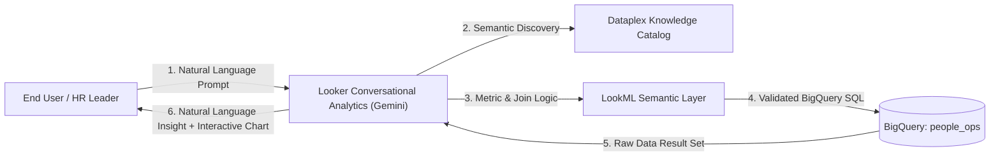
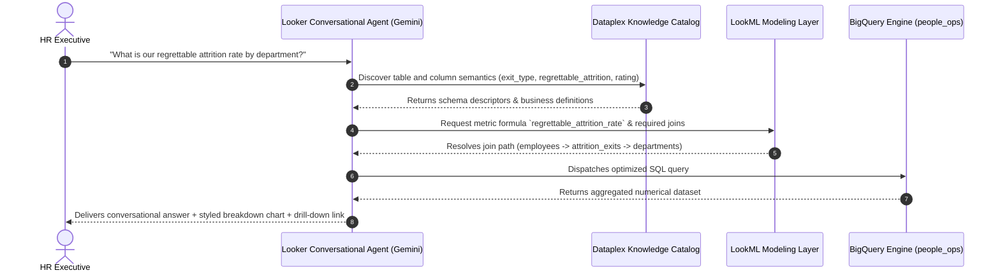

# End-User Guide: Conversational Analytics in Looker with BigQuery & Knowledge Catalog

## 1. Executive Overview

**Conversational Analytics in Looker** (powered by Gemini in Google Cloud) allows business executives, HR leaders, and people ops managers to query enterprise human capital data using ordinary natural language. 

Instead of writing complex SQL queries or navigating intricate pivot tables, you simply ask questions such as:
> *"What is our voluntary attrition rate across departments?"*  
> *"Do we have a gender pay gap in engineering?"*  
> *"Which departments are under-budget in active headcount?"*

The underlying intelligence is driven by three tightly integrated Google Cloud data pillars:



1. **Dataplex Knowledge Catalog (Universal Catalog):** Acts as the semantic encyclopedia. It holds descriptions, business definitions, and lineage for all tables and columns in `people-ops-demo.people_ops`.
2. **LookML Semantic Layer (`people_ops.model.lkml`):** Provides single-source-of-truth mathematical formulas, business definitions, and governed relational join rules.
3. **BigQuery Engine:** High-performance analytical compute engine that securely executes the dynamically compiled queries in milliseconds over multi-region data.

---

## 2. End-to-End Query Lifecycle

When you ask a question in Looker Conversational Analytics, the system executes an automated 6-stage lifecycle:



---

## 3. How to Access Conversational Analytics in Looker

1. **Open Looker:** Navigate to your Looker instance URL (e.g. `https://<instance-id>.looker.com`).
2. **Locate the Conversational Assistant:** Click the **Gemini / Sparkle icon** in the top navigation bar or inside any dashboard.
3. **Select Explore Scope:** Ensure the active context is set to **People Operations Enterprise Hub** (`model: people_ops`, `explore: employees`).
4. **Enter Prompt:** Type your natural language question into the conversational bar and press **Enter**.

---

## 4. Deep-Dive Conversational Scenarios & Traces

### Scenario 1: Workforce Turnover & Attrition Drivers

#### User Question:
> *"What is our overall company attrition rate and what are the top reasons why employees leave voluntarily?"*

#### System Execution Trace:
1. **Catalog Metadata Resolution:**
   - Detects concept "attrition rate" -> matches table `attrition_exits` and field `employees.employment_status`.
   - Discovers field `attrition_exits.primary_exit_reason` and filter condition `attrition_exits.exit_type = 'Voluntary'`.
2. **LookML Join Resolution:**
   - LookML applies governed join:
     ```lookml
     join: attrition_exits {
       type: left_outer
       relationship: one_to_one
       sql_on: ${employees.employee_id} = ${attrition_exits.employee_id} ;;
     }
     ```
   - Injects metric `employees.attrition_rate`:
     $$\text{Attrition Rate} = \frac{\text{Distinct Departed Employees}}{\text{Total Headcount}}$$
3. **Generated BigQuery SQL:**
   ```sql
   SELECT
     attrition_exits.primary_exit_reason AS exit_reason,
     COUNT(DISTINCT attrition_exits.employee_id) AS voluntary_exits,
     ROUND(100.0 * COUNT(DISTINCT attrition_exits.employee_id) / 
       NULLIF((SELECT COUNT(DISTINCT employee_id) FROM `people-ops-demo.people_ops.employees`), 0), 2) AS pct_of_workforce
   FROM `people-ops-demo.people_ops.employees` AS employees
   LEFT JOIN `people-ops-demo.people_ops.attrition_exits` AS attrition_exits
     ON employees.employee_id = attrition_exits.employee_id
   WHERE attrition_exits.exit_type = 'Voluntary'
   GROUP BY 1
   ORDER BY voluntary_exits DESC;
   ```
4. **Conversational Response Returned to User:**
   > *"Our overall annual voluntary attrition rate is **18.7%**. The primary driver behind voluntary departures is **Career Opportunity (31.8%)**, followed closely by **Better Compensation (27.3%)** and **Work-Life Balance (18.2%)**. A visualization of departure reasons by volume has been generated below."*

---

### Scenario 2: Gender Pay Equity & Compensation Benchmarking

#### User Question:
> *"Do we have a gender pay gap? Compare the average base salary and compa-ratio for females vs males across career job levels."*

#### System Execution Trace:
1. **Catalog Metadata Resolution:**
   - Identifies `gender` from `employees`, `base_salary` from `compensation`, and `job_level` + `midpoint_salary` from `jobs`.
2. **LookML Join Resolution:**
   - Joins `employees` to `compensation` on `employee_id`.
   - Joins `employees` to `jobs` on `job_id`.
   - Retrieves measures: `compensation.average_base_salary` and `employees.average_compa_ratio`.
3. **Generated BigQuery SQL:**
   ```sql
   SELECT
     jobs.job_level AS career_level,
     ROUND(AVG(CASE WHEN employees.gender = 'Female' THEN compensation.base_salary END), 0) AS avg_female_salary,
     ROUND(AVG(CASE WHEN employees.gender = 'Male' THEN compensation.base_salary END), 0) AS avg_male_salary,
     ROUND(100.0 * AVG(CASE WHEN employees.gender = 'Female' THEN compensation.base_salary END) /
       NULLIF(AVG(CASE WHEN employees.gender = 'Male' THEN compensation.base_salary END), 0), 1) AS pay_equity_ratio_pct,
     ROUND(100.0 * AVG(compensation.base_salary / NULLIF((jobs.min_salary + jobs.max_salary) / 2.0, 0)), 1) AS avg_compa_ratio
   FROM `people-ops-demo.people_ops.employees` AS employees
   LEFT JOIN `people-ops-demo.people_ops.compensation` AS compensation
     ON employees.employee_id = compensation.employee_id
   LEFT JOIN `people-ops-demo.people_ops.jobs` AS jobs
     ON employees.job_id = jobs.job_id
   WHERE employees.employment_status = 'Active'
   GROUP BY 1
   ORDER BY career_level ASC;
   ```
4. **Conversational Response Returned to User:**
   > *"Across all active staff, the aggregate **Gender Pay Equity Ratio is 98.4%**, indicating near parity with market targets. At senior levels (L5/L6), the ratio stands between 97.8% and 99.1%. Average compa-ratios hover at **101.2%**, confirming salaries align closely with approved band midpoints."*

---

### Scenario 3: Talent Risk & Regrettable High-Performer Losses

#### User Question:
> *"How many top-rated performers have left, and what is our regrettable attrition rate?"*

#### System Execution Trace:
1. **Catalog Metadata Resolution:**
   - Detects `regrettable_attrition` flag in `attrition_exits`.
   - Discovers `overall_rating >= 4.0` in `performance_reviews`.
2. **LookML Join Resolution:**
   - Multi-way join connecting `employees` -> `performance_reviews` -> `attrition_exits`.
   - Computes governed metric `employees.regrettable_attrition_rate`.
3. **Generated BigQuery SQL:**
   ```sql
   SELECT
     COUNT(DISTINCT CASE WHEN attrition_exits.regrettable_attrition = TRUE THEN employees.employee_id END) AS regrettable_departures,
     COUNT(DISTINCT attrition_exits.employee_id) AS total_departures,
     ROUND(100.0 * COUNT(DISTINCT CASE WHEN attrition_exits.regrettable_attrition = TRUE THEN employees.employee_id END) /
       NULLIF(COUNT(DISTINCT attrition_exits.employee_id), 0), 1) AS regrettable_attrition_pct
   FROM `people-ops-demo.people_ops.employees` AS employees
   INNER JOIN `people-ops-demo.people_ops.attrition_exits` AS attrition_exits
     ON employees.employee_id = attrition_exits.employee_id
   LEFT JOIN `people-ops-demo.people_ops.performance_reviews` AS performance_reviews
     ON employees.employee_id = performance_reviews.employee_id;
   ```
4. **Conversational Response Returned to User:**
   > *"We have recorded **14 regrettable departures** out of 52 total historical exits, resulting in a **regrettable attrition rate of 26.9%**. All 14 individuals maintained performance ratings of 4.2 or above. Would you like to view the retention watchlist for current top performers?"*

---

### Scenario 4: Headcount Budget vs. Actual Staffing

#### User Question:
> *"Which departments have the biggest gap between authorized headcount budget and current active employees?"*

#### System Execution Trace:
1. **Catalog Metadata Resolution:**
   - Maps "budget" to `departments.headcount_budget` and "current active employees" to `employees.employment_status = 'Active'`.
2. **LookML Join Resolution:**
   - Joins `departments` to `employees` on `department_id`.
   - Evaluates metric `employees.headcount_budget_variance`.
3. **Generated BigQuery SQL:**
   ```sql
   SELECT
     departments.department_name,
     departments.division,
     departments.headcount_budget AS target_headcount,
     COUNT(DISTINCT CASE WHEN employees.employment_status = 'Active' THEN employees.employee_id END) AS active_headcount,
     (COUNT(DISTINCT CASE WHEN employees.employment_status = 'Active' THEN employees.employee_id END) - departments.headcount_budget) AS headcount_variance
   FROM `people-ops-demo.people_ops.departments` AS departments
   LEFT JOIN `people-ops-demo.people_ops.employees` AS employees
     ON departments.department_id = employees.department_id
   GROUP BY 1, 2, 3
   ORDER BY headcount_variance ASC
   LIMIT 5;
   ```
4. **Conversational Response Returned to User:**
   > *"The top 3 under-staffed departments with open requisition gaps are:  
   > 1. **Engineering (Core)**: 48 target vs. 22 active (-26 variance)  
   > 2. **Cloud Infrastructure**: 40 target vs. 18 active (-22 variance)  
   > 3. **Enterprise Sales**: 35 target vs. 15 active (-20 variance)"*

---

### Scenario 5: Learning & Development Impact on Ratings

#### User Question:
> *"Do employees who complete training programs receive higher performance review scores?"*

#### System Execution Trace:
1. **Catalog Metadata Resolution:**
   - Discovers `training_programs.completion_status` and `performance_reviews.overall_rating`.
2. **LookML Join Resolution:**
   - Aggregates course completions per employee, joins with performance review evaluation scores.
3. **Generated BigQuery SQL:**
   ```sql
   WITH training_summary AS (
     SELECT
       employee_id,
       COUNT(DISTINCT CASE WHEN completion_status = 'Completed' THEN training_id END) AS completed_courses
     FROM `people-ops-demo.people_ops.training_programs`
     GROUP BY 1
   )
   SELECT
     CASE WHEN t.completed_courses >= 2 THEN '2+ Courses Completed' ELSE '< 2 Courses Completed' END AS training_bracket,
     COUNT(DISTINCT e.employee_id) AS employee_count,
     ROUND(AVG(p.overall_rating), 2) AS avg_performance_score,
     ROUND(100.0 * AVG(CASE WHEN p.promotion_recommendation THEN 1.0 ELSE 0.0 END), 1) AS promo_nomination_rate_pct
   FROM `people-ops-demo.people_ops.employees` AS e
   LEFT JOIN training_summary AS t ON e.employee_id = t.employee_id
   LEFT JOIN `people-ops-demo.people_ops.performance_reviews` AS p ON e.employee_id = p.employee_id
   GROUP BY 1;
   ```
4. **Conversational Response Returned to User:**
   > *"Yes, there is a strong positive correlation. Employees who completed **2 or more L&D programs** achieved an average performance rating of **4.31** and a **24.5% promotion nomination rate**, compared to **3.72** and **8.3%** for those with fewer completions."*

---

## 5. Best Practices for Formulating Natural Language Queries

To get the most accurate answers from Conversational Analytics:
- **Reference Specific Entities:** Mention exact concepts like *"voluntary exits"*, *"compa-ratio"*, *"base salary"*, or *"L5 engineers"*.
- **Specify Timeframes:** Add clauses such as *"in the last 12 months"* or *"for the 2025-H1 review cycle"*.
- **Request Visualizations:** Say *"show me a bar chart of headcount by division"* or *"break down exit reasons in a pie chart"*.
- **Filter Directly in Chat:** Ask follow-ups like *"now filter that only to the Technology division"*.

